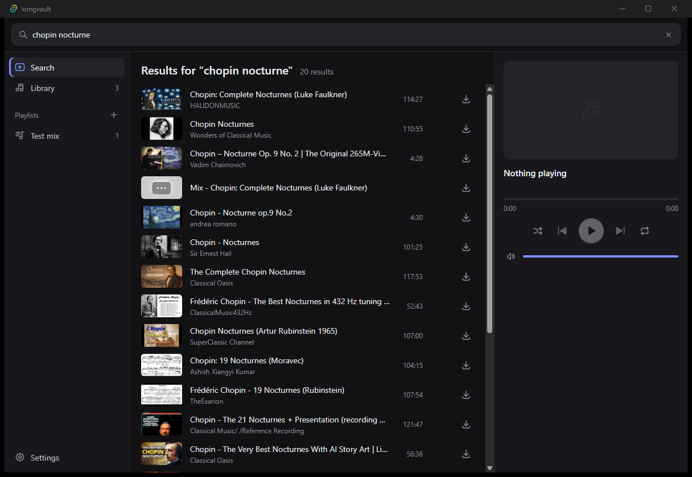
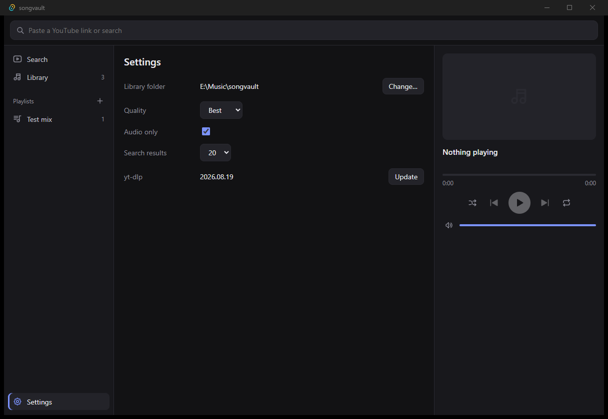

<p align="center">
  
</p>

<h1 align="center">songvault</h1>

<p align="center">
  A Windows desktop app that downloads songs from YouTube and keeps them in a local library with playlists.
</p>

<p align="center">
  <a href="https://github.com/RepousiosJim/songvault/releases/latest"><b>Download for Windows</b></a>
  ·
  <a href="#build-from-source">Build from source</a>
  ·
  <a href="LICENSE">MIT license</a>
</p>

| Search | Settings |
| --- | --- |
|  |  |

## Features

**Download**
- Paste a YouTube link to look it up. It appears as a search result: preview it, then download it as MP4 video, or as M4A when Audio only is on.
- Cap video quality at 1080p, 720p or 480p to save space.
- Paste a playlist link to list its songs, then **Import playlist** to create a songvault playlist from it. Songs already in your library are added at once and the rest download in order.
- Downloads run three at a time; the rest wait in the queue.
- A progress pill tracks every download. If a download fails, you can open yt-dlp's full log.

**Search**
- Search YouTube from the same field, with suggestions as you type. Searches in any language and script work, including Cyrillic and Greek.
- Preview a result's audio before downloading it.

**Library and playlists**
- After each download, pick a playlist for the song or create a new one.
- Rename playlists and drag songs to reorder them.
- Filter the library by title or channel.
- Smart lists build themselves: recently added, most played, and not played lately.

**Player**
- Built-in player with seek, shuffle, repeat, volume and an up-next queue.
- Double-click the video for fullscreen.
- Export a playlist as an `.m3u8` file for other players.
- Updates itself: a button appears in the top bar when a new version is released.

## Install

1. Download `songvault_<version>_x64-setup.exe` from [Releases](https://github.com/RepousiosJim/songvault/releases/latest).
2. Run it. It installs for your user account only and needs no admin rights.
3. Windows SmartScreen may show "Windows protected your PC" because the installer is not code-signed. Choose **More info**, then **Run anyway**.

On first launch songvault downloads the tools it runs on: yt-dlp, ffmpeg and Deno. They total about 150 MB and are downloaded once. Nothing else needs installing.

Requires Windows 10 or 11, 64-bit.

## Settings

| Setting | Default | Notes |
| --- | --- | --- |
| Library folder | `Music\songvault` | When you change it, choose whether to move your songs or start with the library in the new folder. |
| Quality | Best | Highest video height to download. |
| Audio only | Off | Saves M4A audio instead of MP4 video. |
| Cut non-music parts | On | Removes non-music sections (intros, talking) from downloads using SponsorBlock data. |
| Even volume | On | Plays loud songs a little quieter so levels match. Files are not changed. |
| Search results | 20 | Number of results per search. |
| yt-dlp | — | Shows the version. It updates itself once a week; **Update** runs the updater now. |

## Where files live

| What | Location |
| --- | --- |
| Songs and `library.json` (songs and playlists) | The library folder, `Music\songvault` by default |
| Settings | `%APPDATA%\com.gemelon.songvault\settings.json` |
| yt-dlp, ffmpeg, Deno | `%LOCALAPPDATA%\com.gemelon.songvault\bin` |

Songs are plain media files named `Artist - Title [video ID]`, with title, artist and cover art embedded, so any player can open them. To move to another PC, copy the library folder, then select it in Settings.

## Troubleshooting

| Problem | Fix |
| --- | --- |
| Downloads or search fail | Settings → yt-dlp → **Update**. Open the failed download in the progress pill to read the full log. |
| First-launch setup fails | Check your internet connection and choose **Retry**. Setup resumes with whatever is still missing. |
| Tools seem broken | Close songvault, delete the `bin` folder above, and start songvault again to download fresh copies. |

## Build from source

Requires [Rust](https://rustup.rs), [Node.js](https://nodejs.org) 20+ and [pnpm](https://pnpm.io).

```powershell
git clone https://github.com/RepousiosJim/songvault.git
cd songvault
pnpm install
pnpm tauri dev      # run with hot reload
pnpm tauri build    # installer in src-tauri/target/release/bundle/nsis
```

Run the Rust tests with `cargo test` in `src-tauri`.

| Path | Contents |
| --- | --- |
| `src/` | React UI: `App.tsx` (views), `Player.tsx`, `Setup.tsx` (first-run download) |
| `src-tauri/src/` | Rust backend: `ytdlp.rs` (download, search, progress), `library.rs`, `settings.rs`, `tools.rs` (tool download), `suggest.rs` |
| `app-icon.svg` | Icon source. Regenerate the icon set with `pnpm tauri icon app-icon.svg` |

## Releasing

Updates are signed. Generate a key once with `pnpm tauri signer generate -w ~/.tauri/songvault.key` and keep the private key out of the repository. Its public half is `plugins.updater.pubkey` in `src-tauri/tauri.conf.json`.

1. Bump the version in `package.json`, `src-tauri/Cargo.toml` and `src-tauri/tauri.conf.json`.
2. Set `TAURI_SIGNING_PRIVATE_KEY` to the key file's path or contents (plus `TAURI_SIGNING_PRIVATE_KEY_PASSWORD` if it has a password) and run `pnpm tauri build`.
3. Create a GitHub release and upload the installer from `src-tauri/target/release/bundle/nsis`, its `.sig` file, and a `latest.json`. Installed copies read `latest.json` from the latest release:

```json
{
  "version": "0.2.0",
  "pub_date": "2026-01-01T00:00:00Z",
  "platforms": {
    "windows-x86_64": {
      "signature": "<contents of the .sig file>",
      "url": "https://github.com/RepousiosJim/songvault/releases/download/v0.2.0/songvault_0.2.0_x64-setup.exe"
    }
  }
}
```

## Built with

[Tauri 2](https://tauri.app) · [React](https://react.dev) · [yt-dlp](https://github.com/yt-dlp/yt-dlp) · [FFmpeg](https://ffmpeg.org) ([yt-dlp builds](https://github.com/yt-dlp/FFmpeg-Builds)) · [Deno](https://deno.com) · [Tabler Icons](https://tabler.io/icons)

## Disclaimer

Download only content you have the right to download. Respect YouTube's Terms of Service and the creators' copyright. songvault is not affiliated with YouTube or Google.

## License

[MIT](LICENSE)
